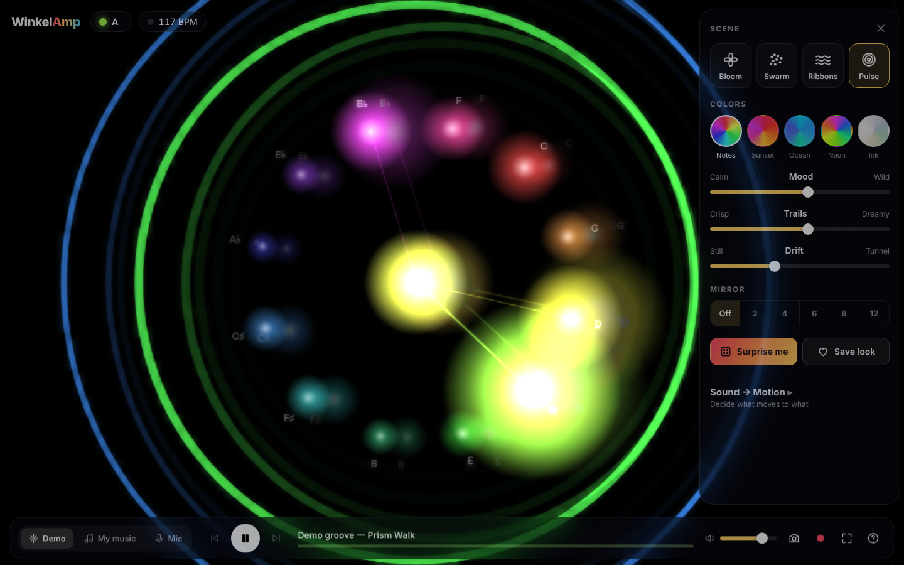
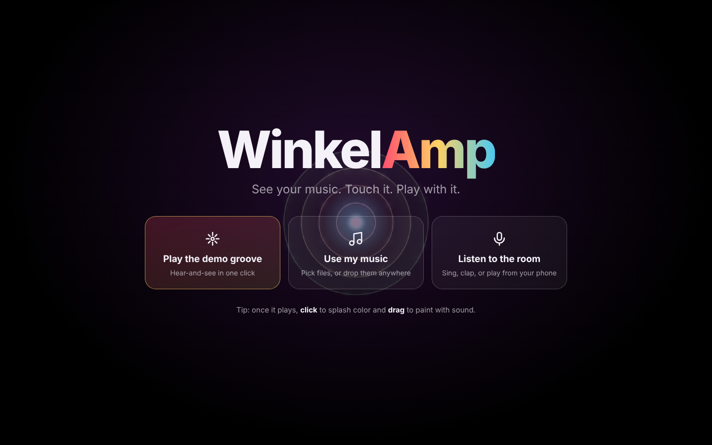
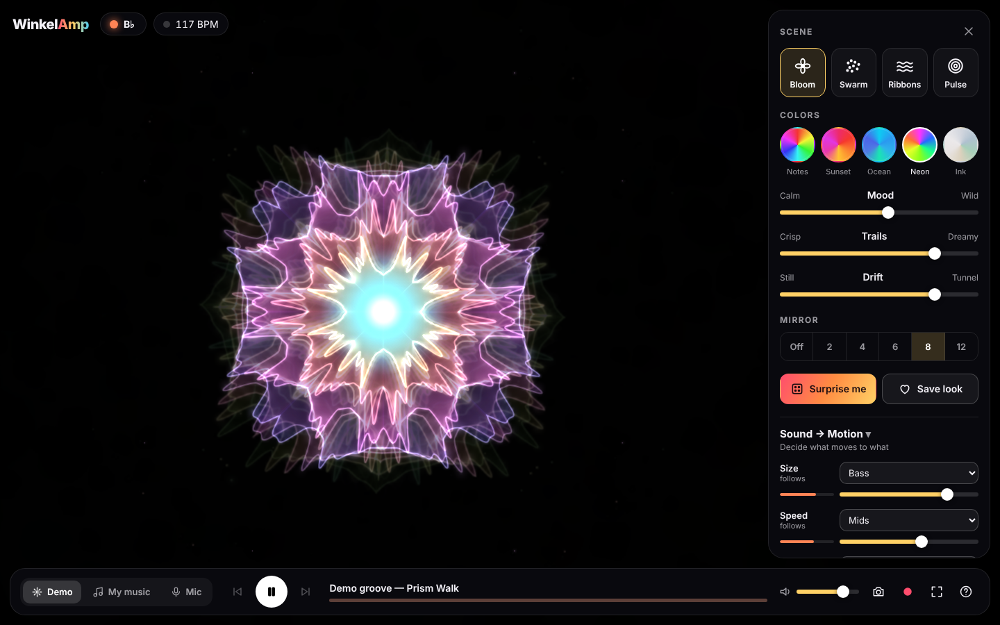
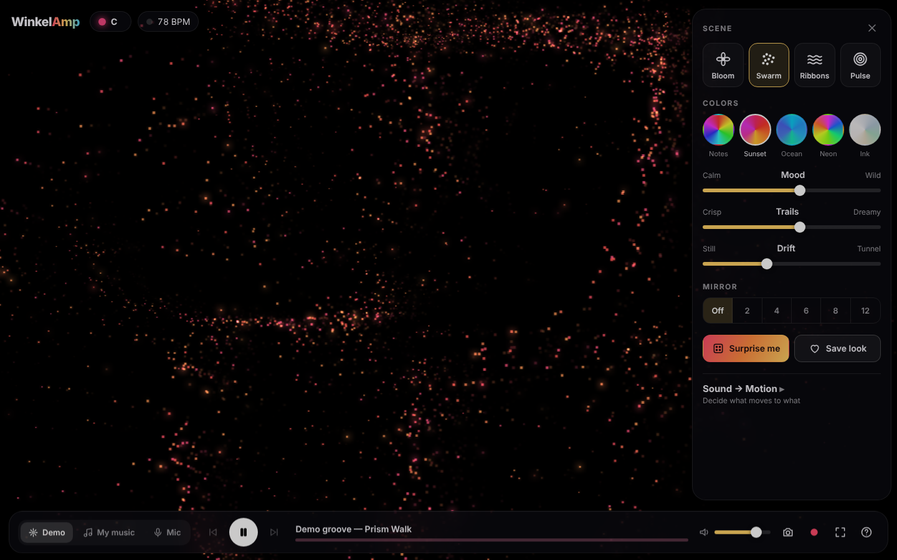
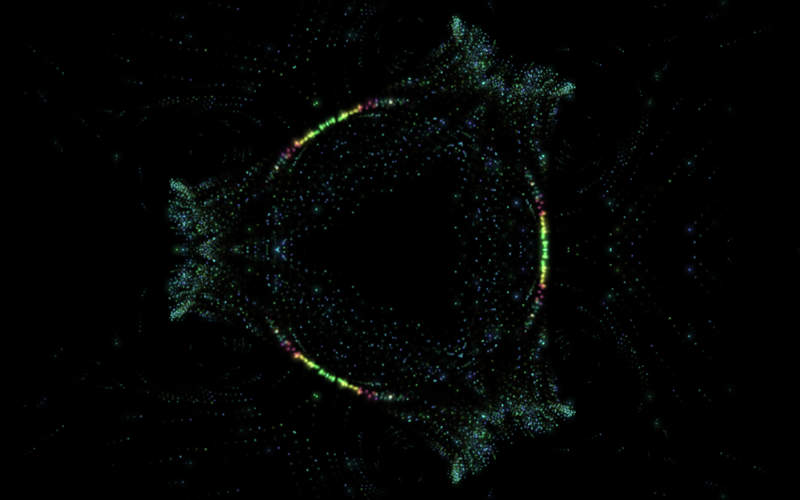

# WinkelAmp

**See your music. Touch it. Play with it.**

WinkelAmp is a synesthesia player: it turns sound and rhythm into movement and color.
It's the spirit of Winamp + MilkDrop, rebuilt to be easy to use, interactive and made
for experimenting rather than for watching.



| | |
|---|---|
|  |  |
|  |  |

A one-minute tour (headless capture, so it's choppier than the real thing):
[`docs/media/tour.mp4`](docs/media/tour.mp4)

## Try it

```bash
npm install
npm run dev
```

Open the printed URL, then pick one of three ways in:

- **Play the demo groove**: a built-in generative track, so there's always something to try.
- **Use my music**: pick audio files, or drop them anywhere on the window (mp3, wav, ogg, flac, m4a…).
- **Listen to the room**: the microphone. Play music from your phone, sing or clap.

## Playing with it

| Do this | And this happens |
|---|---|
| **Click** the picture | A splash in the color of the note you're hearing |
| **Drag** | Paint with the sound: loudness sets the brush size, pitch sets the color |
| **Scroll** | Zoom |
| **Scene** cards | Bloom · Swarm · Ribbons · Pulse |
| **Colors** | Notes (pure synesthesia) · Sunset · Ocean · Neon · Ink |
| **Mood** | Calm ↔ Wild |
| **Trails** | Crisp ↔ Dreamy |
| **Drift** | Still ↔ Tunnel (the classic zoom-feedback) |
| **Mirror** | Kaleidoscope, 2–12 way; painting with a mirror draws mandalas |
| **Surprise me** | A tasteful random look |
| **Save look** | Keeps the whole setup as a one-click chip |
| **Sound → Motion** | Choose which part of the sound drives Size, Speed, Spin, Glow, Shake, Color shift and Zoom, with live meters |
| 📷 / ⏺ | Save a picture / record a video *with* the audio |

Keyboard: `Space` play/pause · `1`–`4` scenes · `R` surprise · `M` mirror ·
`H` hide interface · `F` fullscreen · `←`/`→` tracks · `?` help.

The interface fades away by itself after a few seconds of stillness.

## How sound becomes color and motion

| Sound | Becomes |
|---|---|
| Pitch class (C … B) | **Hue**, arranged by the circle of fifths so harmonically close notes get close colors and a key change shifts the mood |
| Tonal vs. noisy | **Saturation**: chords are vivid, drums turn into white sparks |
| Loudness | **Brightness** |
| Bass / mids / highs | **Size / speed / glow** by default (re-patchable) |
| Beats | **Impulses**: bursts, rings, camera kicks |
| Tempo | Shown live; drives the rhythm of the pulses |

The full reasoning is in [docs/DESIGN.md](docs/DESIGN.md), and a critique of the
first build is in [docs/DESIGN-CRITIQUE.md](docs/DESIGN-CRITIQUE.md).

## Project layout

```
src/
  audio/features.ts   pure analysis: bands, auto-gain, onsets, tempo, chroma, centroid (unit-tested)
  audio/engine.ts     Web Audio graph: demo / files / mic → analyser, recorder tap
  audio/demo.ts       the generative demo groove (changes key on purpose)
  mapping.ts          the Sound → Motion patch bay
  settings.ts         looks: defaults, surprise, save/restore
  visual/color.ts     palettes and note → color
  visual/renderer.ts  feedback → scene → kaleidoscope → additive composite + glow
  visual/scenes/*     Bloom, Swarm, Ribbons, Pulse
  ui/                 the Look panel and icons
  main.ts             wiring, keyboard, pointer, idle-hiding
tests/                vitest unit tests for the analysis, color and looks
scripts/screenshots.mjs   drives the app in headless Chromium for docs/media
```

## Scripts

```bash
npm run dev          # dev server
npm test             # unit tests
npm run build        # type-check + production build into dist/
npm run shots        # screenshots into docs/media (dev server must be running; add -- --video for a tour)
```

`.github/workflows/pages.yml` publishes `dist/` to GitHub Pages on every push to
`main`, once Pages is enabled for the repository (Settings → Pages → Source:
GitHub Actions).

## Ideas for next steps

- WebGL shader scenes (real bloom, fluid simulation)
- Share a look as a link
- MIDI controller support: map knobs to Mood / Trails / Drift
- Gentler defaults when the system asks for reduced motion
- Audio from other tabs via screen-share capture (Spotify and similar services don't expose raw audio to web pages)
