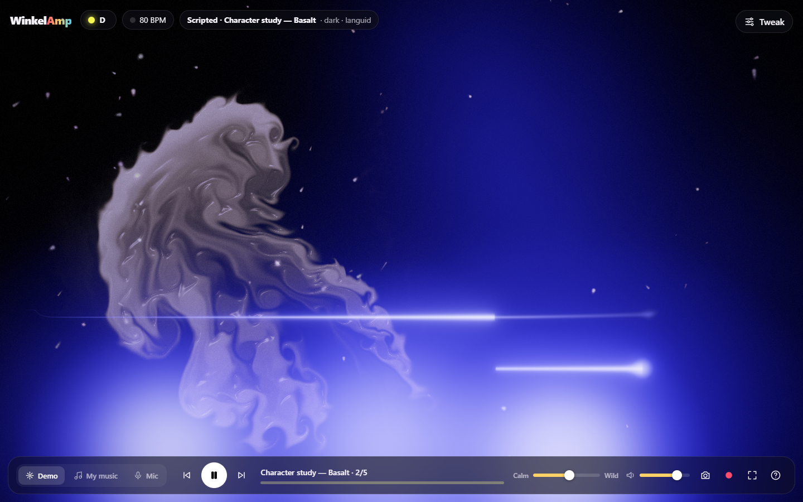

# WinkelAmp

**A recording becomes a show of abstract pictures, set off by every note it plays.**

WinkelAmp is a studio for visual music. Drop in a recording of a piece (the great masters first: Rachmaninoff,
Beethoven…); its notes are transcribed once by a GPU piano model, and a show of hand-made canvas widgets plays
with it section by section, in sync with every attack. Reshape the show with the mouse (which widgets, where the
sections change, each widget's knobs), or have Claude compose it from a description in your own words.

## Try it

```bash
npm install
npm run ears    # in its own terminal: transcribes dropped recordings with the GPU piano model
npm run dev
```

Open the printed URL: the studio. **Drop a recording** anywhere on the page (or **Songs → Add a recording…**): the
ears server transcribes its notes once (the piano model in `C:/Users/maxim/.venvs/wa`, or `$WINKELAMP_PY`; a minute
of music takes ten-odd seconds on the GPU) and the song opens. Without `npm run ears` the browser analyses the
recording itself and makes **approximate** notes (the song and the library say so; **Re-ingest with the transcriber**
fixes it once ears runs). From a terminal, `npm run ingest -- path/to/recording.mp3 --title "Rachmaninoff: Prelude in
C♯ minor"` does the same as a drop.

Pick a song under **Songs**; a song without a show of its own gets one composed from its analysis and the widgets
you loved. Then:

- **Play** (Space), seek on the timeline, `←` / `→` five seconds, `Shift` + arrows from section to section.
- **The timeline** shows the music's activity in each section's colour (the colour of its bottom widget). Click a
  section to select it; drag a boundary to move it (it snaps just before an attack; hold Alt to drag freely);
  **Split at playhead** (S) and **Merge with next**.
- **The side panel** holds the selected section: its name, how the widgets leaving at its start fade out, and its
  layers, top first. **Add a widget on top** opens the collection with your verdicts from the lab; each layer
  opens to its knobs, drawn as the lab draws them (a picture at each end, the live one moving with the music, the
  `i` hint, and what the knob follows: fixed, louder → more, …). Delete (or Backspace) removes the selected layer.
- **Undo** (Ctrl+Z), **redo** (Ctrl+Shift+Z), **Save show** (Ctrl+S) writes `shows/<song>.json`.
- **Show** tab: *Describe the show* saves your words to `shows/<song>.description.md`; ask Claude Code to compose
  the show from it ([docs/COMPOSING-SHOWS.md](docs/COMPOSING-SHOWS.md), `npm run check-show`).
- **F** full screen, **H** hides the controls.
- **Each layer** can also *listen to* one part (a track of the recording such as Violins or Cellos, a family, or a
  line worked out from the notes: melody, bass line, inner voices, low, high, accents), be seen only in a **place**
  (a spotlight or a window you drag, turn and soften on the stage), and follow an **intensity** curve drawn in a lane
  under the timeline like DJ automation (presets: fade in or out, swell, pulse every beat or bar, gate on loudness,
  while its part plays). Lower intensity means fewer attacks, a fainter picture and a calmer pulse.
  [docs/COMPOSING-SHOWS.md](docs/COMPOSING-SHOWS.md) explains all three.
- **Add a widget** filters the collection by feel words (icy, liquid, stabbing…), by instrument, and by what suits
  this song's instruments.
- **Export → Record video** records the show to an MP4 (H.264 + AAC) while the song plays through once, from the
  start or from the playhead; the song's end saves it to your downloads. *For sharing* is 1.9 Mbit/s (about 15 MB a
  minute), *High quality* 8 Mbit/s (about 61); both 720p at 30 fps. Keep the tab in front: hiding it pauses the
  recording.
- **Export → Render HD master** (dev server only) draws the show frame by frame on this computer, from the start or
  from the playhead, with a progress bar and the time left: a 2560×1440 60 fps master plus a share copy in
  `renders/`. The same from a terminal: `npm run render-show -- <song>` (below).

### The HD master and the share copy

```bash
npm run render-show -- <show id | shows/x.json> [--scale 2] [--fps 60] [--from s] [--to s] [--no-share] [--share-mb-per-min 15]
```

- **The master** (`renders/<id>.mp4`): the show supersampled (drawn at 2× in 1280×720 units, so every line is sharp),
  2560×1440 at 60 fps, x264 crf 13, BT.709 with its colour tags, and the recording's sound sample for sample (AAC
  320k). Frames leave the page losslessly, and the same show gives the same frames every time. It takes 3 to 10 s per
  second of video on this machine at 2×, depending on the widgets (horizon is the costliest), so a 4-minute song takes
  15 to 45 minutes; the ETA printed at the start samples the song's drawing cost first. `--scale 1 --fps 30 --crf 18 --no-share` gives the old quick 720p kind.
- **The share copy** (`renders/<id>-share.mp4`): made from the master, 1920×1080 at 30 fps, two-pass x264 at about
  15 MB a minute (1.87 Mbit/s + AAC 128k). **Send it in WhatsApp as a *document*** (attach → Document), not as a
  video, or WhatsApp squeezes it again. For a smaller file pass `--share-mb-per-min 7`.
- **The contact sheet** (`renders/<id>-sheet.png`): one frame every 10 s, to look at before sending.

### Instrument tracks: YourMT3+ (optional)

Piano recordings need only the piano model. For ensembles (a symphony, a concerto) the ingest also runs
[YourMT3+](https://huggingface.co/spaces/mimbres/YourMT3), which writes one note track per instrument it hears
(violins, violas, cellos, horns, oboe…); those become the parts a layer can listen to, and fill the piano model's
gaps. It is installed **outside the repo** and never vendored:

1. Download the Hugging Face Space `mimbres/YourMT3` (with git-lfs, for its checkpoints) somewhere.
2. Make a Python 3.11 venv from `scripts/ears/requirements-ymt3.txt` (default `C:/Users/maxim/.venvs/wa-mt`; torch
   with CUDA).
3. `npm run setup-ymt3 -- --from <the Space folder> [--python <venv python>] [--dir <install>]` copies the model code
   and the MoE checkpoint (sha256-checked) to `%LOCALAPPDATA%/WinkelAmp/ymt3`, probes it, and writes `ymt3.json` there.
   `WINKELAMP_YMT3` points at another install (its folder or its `ymt3.json`).

The YourMT3 code is Apache-2.0 (its source headers); check the Space's model card for the checkpoints' terms before
sharing anything made from them. Without YourMT3 nothing fails: an ensemble falls back to basic-pitch for the gaps
(`WINKELAMP_PY_BP`, default the venv `C:/Users/maxim/.venvs/wa-bp`), then to the piano model alone, with a warning in
the pack, in `npm run ears`'s `/health` and in the studio's words.

### Ingest

```bash
npm run ingest -- <audio> [--id <slug>] [--title "<t>"] [--notes auto|gpu|hybrid|ymt3|bp|approx|<notes file>]
                  [--piano-notes <notes file>] [--kind auto|piano|ensemble] [--redo piano|ymt3|bp] [--force] [--progress json]
```

- `--notes auto` (the default) runs the piano model and YourMT3+, calls the recording *piano* or *ensemble* from
  YourMT3's piano share, and for an ensemble fills the piano model's gaps with YourMT3's notes and writes the
  instrument tracks. Anything missing falls back a row, with a warning; `auto` never fails for a missing transcriber.
- `gpu`, `hybrid`, `ymt3`, `bp` insist on those transcribers (exit 3 without them); `approx` uses the analysis only; a
  notes file is used as is.
- `--kind piano|ensemble` overrides the call; `--piano-notes` uses a notes file as the piano model's notes;
  `--redo` re-runs one transcriber instead of reading its cache (each is cached in the song's folder by the audio's
  sha1); `--progress json` prints machine-readable progress (the ears server uses it).
- `npm run describe-song -- <id>` then lists the tracks and where each instrument plays; `npm run pianoroll` draws
  piano rolls of them.

### Have Claude compose a show

Write what you want to see in the **Show** tab's *Describe the show* box (it is saved to
`shows/<song>.description.md`), then ask a Claude Code session in this repository to compose the show from it. The
session follows [docs/COMPOSING-SHOWS.md](docs/COMPOSING-SHOWS.md):

```bash
npm run describe-song -- <song>                  # the song in words: sections, their character, loudness, attacks
# read shows/<song>.description.md, write shows/<song>.json (sections → widget stacks, knobs where the words ask)
npm run check-show -- shows/<song>.json          # exit 0 = it plays; --fix repairs overlaps, gaps and typos
npm run render-show -- <song> --from 120 --to 135 # a look at one stretch, then a contact sheet of its frames
```

A studio with the song open follows the show as it changes on disk (it asks first if you have unsaved edits).
`shows/rach-prelude-recording.json` and `shows/beethoven5.json` were composed this way from the user's words.

Songs (`songs/<id>/`: the audio and its pack) stay on your machine and out of git; shows are committed. The
widgets live in [`lab/tools/`](lab/README.md): the [widget lab](lab/index.html) is where they are sketched and
rated, and the studio runs the same files, so a widget looks the same in both.

The previous app, which listens live to the microphone, MIDI or files and draws with a WebGL stage, is still
there at **`legacy.html`** (linked from the song library). The rest of this README describes it.

## The old app (legacy.html)



Open `legacy.html` on the dev server, then pick one of three ways in:

- **Play the demos**: four character studies (Ember, Basalt, Sugar Glass, Mist), each with a composed show,
  then a generative groove. `←` / `→` step through them.
- **Use my music**: pick audio files, or drop them anywhere on the window (mp3, wav, ogg, flac, m4a…).
  A recording in the corpus is recognised by its sound and gets its show.
- **Listen to the room**: the microphone. Play music from your phone, sing or clap.

### What you see

- **The stage.** A WebGL2 compositor with a small cast of elements, each following one part of the music:
  the **melody** thread (the tune: higher notes higher, long notes long strokes), **bass** masses, **sparks**
  (quick high notes), the chord **bloom** (harmony), **pulse** (the beat, when there is one), the **fluid**
  (the music's character), and the **wave** (the raw waveform).
- **The music is the clock.** Every motion runs on music time, driven by loudness, onsets and change. In
  silence the picture freezes, then dims to a faint afterimage; it comes back with the sound.
- **Scripted or Live.** The badge says who runs the show, plus the mood in words:
  - *Scripted · <title>*: a show from the corpus. The script decides what is on stage and when (scene
    changes, entrances, accents on the big moments, returning themes); the sound still drives the motion,
    and the melody, beats and sections come from the song's precomputed data, so they land on time
    through pause and seek.
  - *Live*: no script (the mic, MIDI, a song not in the corpus). A director casts by what it hears and
    changes scene on big section changes and real bass drops, never more often than every 15 s.
- **Hardly any knobs.** Transport, volume and one **Calm ↔ Wild** slider. Everything else is in the
  closed **Tweak** drawer: the note and tempo readouts, a scene picker (Auto, the library scenes, Classic),
  colors, trails, drift, mirror, the Sound → Motion patch bay, saved looks and MIDI. A tweak pins that
  setting for the rest of the song; picking a scene pauses the show (*Scripted · paused*; click the badge to
  resume).
- **Classic.** The v1 Canvas2D scenes (Bloom, Swarm, Ribbons, Pulse) are still there, in the drawer or
  on keys `1`–`4`, and they take over by themselves (with a note saying so) where WebGL2 isn't available.
- **MIDI.** Connect a controller in the drawer: knobs map to Wild, Trails, Drift, Glow and more (Learn
  binds any of them), and played keys feed the stage: the held key becomes the melody thread, every key
  a spark, and the key synth is heard and analysed like any other sound.

| Do this | And this happens |
|---|---|
| **Drag** | Paint with the sound (stirs the fluid when it's on stage) |
| **Click** / **Scroll** | Splash color / zoom (Classic) |
| 📷 / ⏺ | Save a picture / record a video *with* the audio (MP4 where the browser can) |

Keyboard: `Space` play/pause · `1`–`4` Classic scenes · `R` surprise · `M` mirror ·
`H` hide interface · `F` fullscreen · `←`/`→` tracks · `?` help.

## How sound becomes picture (the old app)

| Sound | Becomes |
|---|---|
| The tune (predominant melody, tracked live or precomputed) | The **melody thread**: pitch is height, a held note a long stroke, a leap a jump |
| Character (descriptors → archetype blend: fire, sugar, abyss, lament…) | The **mood**: palette, material of the fluid, weight, pace; the words on the badge |
| Pitch class (C … B) | **Hue**, by the circle of fifths, so harmonically close notes get close colors |
| Harmony (chroma, chord changes) | The **bloom**'s color fields |
| Bass, quick high notes, the beat | **Bass masses**, **sparks**, **pulse** |
| Loudness, onsets, change | The **music clock**: how fast everything moves; silence freezes it |
| Section changes, bass drops | **Scene changes**: a blend on a section, a hard cut on a real drop |

The reasoning is in [docs/DESIGN.md](docs/DESIGN.md) (v1) and
[docs/superpowers/specs/2026-10-30-scripted-visuals-design.md](docs/superpowers/specs/2026-10-30-scripted-visuals-design.md)
(the stage, scripts and director).

## Compose a show for the old app

Shows are composed ahead of time, in a Claude Code session, and live in `corpus/` as JSON. The app can't ask
anyone at play time; the composer can't listen, so a **study pack** describes the song in words, numbers and
pictures. The whole craft is in the composer's handbook, [docs/COMPOSING.md](docs/COMPOSING.md).

```bash
npm run study -- song.ogg --id my-song            # study/my-song/ (summary.md, analysis.json, 3 plots)
                                                  # + corpus/my-song.data.json (melody, beats, sections, fingerprint)
# compose corpus/my-song.json from the pack, following docs/COMPOSING.md
npm run check-script -- corpus/my-song.json       # schema, times, references, pacing warnings
npm run preview-script -- my-song song.ogg        # a still after every cue + a contact sheet, in the real app
```

Revise until the contact sheet reads as the music, then commit `corpus/my-song.json` and
`corpus/my-song.data.json` (never the audio; `study/` is git-ignored). The app bundles the corpus and finds the
recording by its fingerprint, whatever its encoding. The first corpus: the four studies, Rachmaninoff's
Prelude in C♯ minor, the Sugar Plum Fairy, Hungarian Dance No. 5, a humpback whale song, drum & bass and a
ragtime.

## Project layout

```
index.html              the studio; legacy.html the old app; render.html frames on demand (render-show, fidelity)
lab/                    the widget lab: lab/tools/*.js are the widgets, lab/index.html the harness and verdicts
src/
  widgets/              the runtime that runs lab/tools/*.js with the lab's ctx, chords, drives and shared canvas
  studio/               pack/ (song packs), show/ (shows, transitions, the Conductor, edits, undo), compose/
                        (the auto-composer), ui/ (the studio page)
  main.ts               the old app's wiring: sources → analysis → script or director → overrides → stage; UI, MIDI, keyboard
  audio/                engine (Web Audio graph, PCM tap, file decode), FFT, features, descriptors,
                        melody tracker/extractor, structure (sections, drops), fingerprint, offline analysis,
                        the generative groove and the four character studies
  character/            descriptors → axes → archetype blend → material; reservoir gestures; palettes
  stage/                the stage: types, music clock, script validator, script player, live director and its
                        scene library, song feed, corpus, overrides, WebGL2 compositor (stage, gl, post) and
                        one file per element in elements/
  visual/               Classic: the v1 Canvas2D renderer and scenes; living/ (the fluid's WebGL2 canvas); recorder
  control/, ui/         MIDI and the key synth; the Tweak drawer and MIDI panel
shows/                  the studio's shows (<song>.json) and their descriptions; songs/ (packs, audio) is local only
corpus/                 the old app's composed shows (<id>.json) and their song data (<id>.data.json)
scripts/                study packs, script checker and preview, screenshots, end-to-end and melody checks
tests/                  vitest unit tests
```

## Scripts

```bash
npm run dev            # dev server: the studio at /, the old app at /legacy.html, the lab at /lab/index.html
npm run ears [-- --port 5175]               # the local server the studio sends dropped recordings to (GPU notes)
npm run ingest -- <audio> [--id <slug>] [--title "<t>"] [--notes gpu|approx|<file>]   # a song pack in songs/<id>/
npm run check-show [-- <file>…] [--fix]     # validate shows/*.json
npm run describe-song -- <id>               # a song pack in words, for composing its show
npm run widget-docs [-- --check]            # regenerate (or check) the widget list in docs/COMPOSING-SHOWS.md
npm run render-show -- <show id | file> [--scale 2] [--fps 60] [--from s] [--to s] [--out renders/<id>.mp4] [--no-share]
                       # the HD master (2560×1440 at 60 fps), its WhatsApp share copy and a contact sheet, frame by frame
                       #   with the recording's sound (a song without a show: the one the studio composes)
npm run setup-ymt3 -- --from <Space folder>  # installs YourMT3+ outside the repo (see above)
npm run lab-notes -- <id>                    # the lab's pack file for a song (lab/pack-<id>.js: tracks, beats, loudness)
npm run pianoroll -- <id> --out <png> [--by track]   # a piano roll of a song, coloured by track, class or line
npm run studio-check   # drives the studio in Chrome on a 30 s test song (starts its own server)
npm run layers-check   # the layer panel: listens to, where, intensity presets, the widget picker's filters
npm run overlay-check  # the region overlay on the stage: drags, Shift, Alt, rotation, feather, undo, never in the picture
npm run lanes-check    # the intensity lanes: add, drag, bend, shapes, presets, undo, save
npm run runtime-check  # instances, routing, intensity and regions in the runtime: seek invariance, spot and window
npm run hd-check       # each widget at 2x is the same picture as at 1x, only sharper (crops in renders/look/hd)
npm run persist-probe  # measures which widgets repaint their picture (the intensity's visibility classes)
npm run record-check [-- --song <id> --seconds 60]   # records in the studio's Export and reads the MP4 Chrome wrote
npm run fidelity       # the studio draws the lab's pixels, widget by widget and with layers (local: needs the lab's notes files)
npm test               # unit tests
npm run build          # type-check + production build into dist/
npm run study -- <file> [--id <slug>]       # a study pack for composing
npm run check-script -- corpus/<id>.json    # validate a script
npm run preview-script -- <id> [<file>]     # stills of a scripted show
npm run shots          # checks the interface in Chrome and saves docs/media shots (starts its own server);
                       #   -- --video also records docs/media/tour.mp4 (needs ffmpeg), -- --seam a study's loop seam
node scripts/e2e-check.mjs <audio dir>      # end-to-end: every corpus recording is recognised, Live
                                            #   changes scene, pause freezes and dims, MIDI keys draw the melody
```

The browser scripts drive the system Chrome through Playwright (real WebGL2 on the GPU).

`.github/workflows/pages.yml` publishes `dist/` to GitHub Pages on every push to
`main`, once Pages is enabled for the repository (Settings → Pages → Source:
GitHub Actions).

## Ideas for next steps

- The studio: shows for more of the repertoire, now that ensembles get instrument tracks; six layers with regions
  at 60 fps in a visible window are not measured yet (the work per step fits; the HD render is not affected); a phone-friendly way to share a show without a
  video
- The old app: share a look as a link; gentler defaults when the system asks for reduced motion; audio from other tabs
  via screen-share capture (Spotify and similar services don't expose raw audio to web pages)
