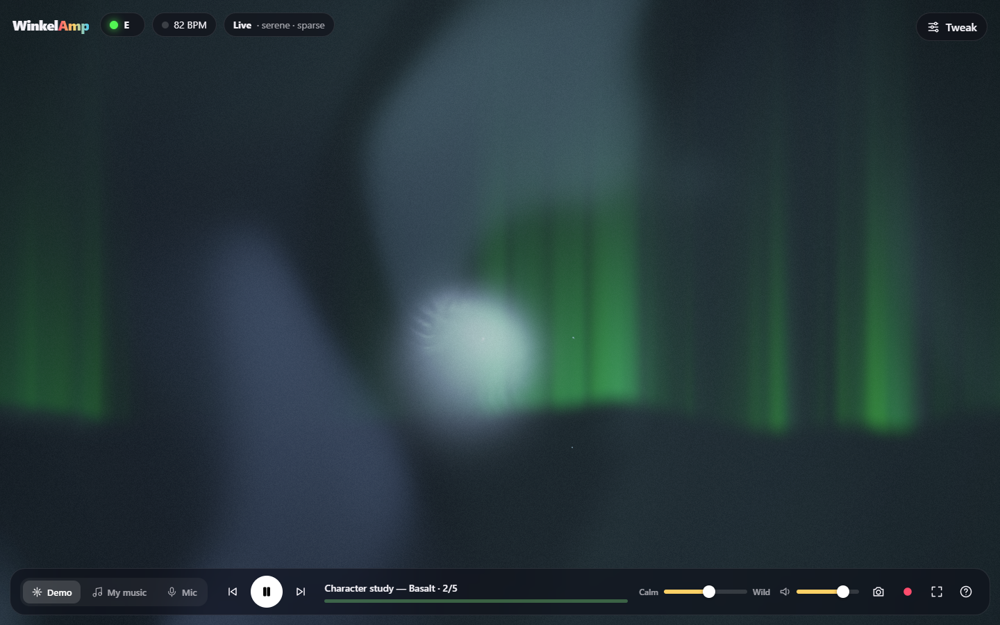
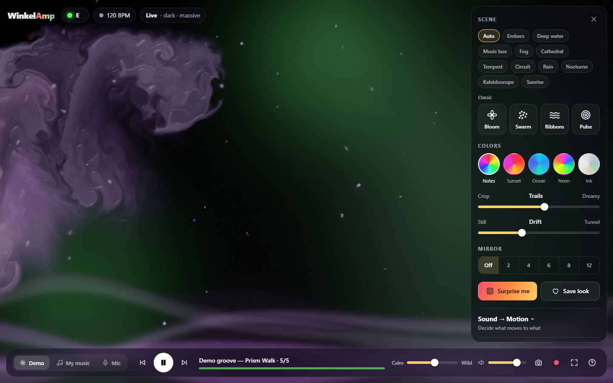

# WinkelAmp

**See your music. Touch it. Play with it.**

WinkelAmp is a synesthesia player: it turns sound and rhythm into movement and color.
It's the spirit of Winamp + MilkDrop, rebuilt to follow the *music*, not just its loudness:
a melody thread traces the tune you hear, the mood of the picture follows the mood of the
music, elements come and go with the parts that play, and big moments get big changes.
For songs it knows, it performs a show composed ahead of time, like a lighting designer
who studied the piece.


| | |
|---|---|
|  |  |
|  |  |

A 50-second tour (headless capture, so it's choppier than the real thing):
[`docs/media/tour.mp4`](docs/media/tour.mp4)

## Try it

```bash
npm install
npm run dev
```

Open the printed URL, then pick one of three ways in:

- **Play the demos**: four character studies (Ember, Basalt, Sugar Glass, Mist), each with a composed show,
  then a generative groove. `←` / `→` step through them.
- **Use my music**: pick audio files, or drop them anywhere on the window (mp3, wav, ogg, flac, m4a…).
  A recording in the corpus is recognised by its sound and gets its show.
- **Listen to the room**: the microphone. Play music from your phone, sing or clap.

## What you see

- **The stage.** A WebGL2 compositor with a small cast of elements, each following one part of the music:
  the **melody** thread (the tune: higher notes higher, long notes long strokes), **bass** masses, **sparks**
  (quick high notes), the chord **bloom** (harmony), **pulse** (the beat, when there is one), the **fluid**
  (the music's character), and the **wave** (the raw waveform).
- **The music is the clock.** Every motion runs on music time, driven by loudness, onsets and change. In
  silence the picture freezes, then dims to a faint afterimage; it comes back with the sound.
- **Scripted or Live.** The badge says who runs the show, plus the mood in words:
  - *Scripted · <title>*: a show from the corpus. The script decides what is on stage and when (scene
    changes, entrances, accents on the big moments, returning themes); the sound still drives the motion,
    and the melody, beats and sections come from the song's precomputed data, so they land on time
    through pause and seek.
  - *Live*: no script (the mic, MIDI, a song not in the corpus). A director casts by what it hears and
    changes scene on big section changes and real bass drops, never more often than every 15 s.
- **Hardly any knobs.** Transport, volume and one **Calm ↔ Wild** slider. Everything else is in the
  closed **Tweak** drawer: a scene picker (Auto, the library scenes, Classic), colors, trails, drift,
  mirror, the Sound → Motion patch bay, saved looks and MIDI. A tweak pins that setting for the rest of the
  song; picking a scene pauses the show (*Scripted · paused*; click the badge to resume).
- **Classic.** The v1 Canvas2D scenes (Bloom, Swarm, Ribbons, Pulse) are still there, in the drawer or
  on keys `1`–`4`, and they take over by themselves (with a note saying so) where WebGL2 isn't available.
- **MIDI.** Connect a controller in the drawer: knobs map to Wild, Trails, Drift, Glow and more (Learn
  binds any of them), and played keys feed the stage: the held key becomes the melody thread, every key
  a spark, and the key synth is heard and analysed like any other sound.

| Do this | And this happens |
|---|---|
| **Drag** | Paint with the sound (stirs the fluid when it's on stage) |
| **Click** / **Scroll** | Splash color / zoom (Classic) |
| 📷 / ⏺ | Save a picture / record a video *with* the audio (MP4 where the browser can) |

Keyboard: `Space` play/pause · `1`–`4` Classic scenes · `R` surprise · `M` mirror ·
`H` hide interface · `F` fullscreen · `←`/`→` tracks · `?` help.

## How sound becomes picture

| Sound | Becomes |
|---|---|
| The tune (predominant melody, tracked live or precomputed) | The **melody thread**: pitch is height, a held note a long stroke, a leap a jump |
| Character (descriptors → archetype blend: fire, sugar, abyss, lament…) | The **mood**: palette, material of the fluid, weight, pace; the words on the badge |
| Pitch class (C … B) | **Hue**, by the circle of fifths, so harmonically close notes get close colors |
| Harmony (chroma, chord changes) | The **bloom**'s color fields |
| Bass, quick high notes, the beat | **Bass masses**, **sparks**, **pulse** |
| Loudness, onsets, change | The **music clock**: how fast everything moves; silence freezes it |
| Section changes, bass drops | **Scene changes**: a blend on a section, a hard cut on a real drop |

The reasoning is in [docs/DESIGN.md](docs/DESIGN.md) (v1) and
[docs/superpowers/specs/2026-10-30-scripted-visuals-design.md](docs/superpowers/specs/2026-10-30-scripted-visuals-design.md)
(the stage, scripts and director).

## Compose a show

Shows are composed ahead of time, in a Claude Code session, and live in `corpus/` as JSON. The app can't ask
anyone at play time; the composer can't listen, so a **study pack** describes the song in words, numbers and
pictures. The whole craft is in the composer's handbook, [docs/COMPOSING.md](docs/COMPOSING.md).

```bash
npm run study -- song.ogg --id my-song            # study/my-song/ (summary.md, analysis.json, 3 plots)
                                                  # + corpus/my-song.data.json (melody, beats, sections, fingerprint)
# compose corpus/my-song.json from the pack, following docs/COMPOSING.md
npm run check-script -- corpus/my-song.json       # schema, times, references, pacing warnings
npm run preview-script -- my-song song.ogg        # a still after every cue + a contact sheet, in the real app
```

Revise until the contact sheet reads as the music, then commit `corpus/my-song.json` and
`corpus/my-song.data.json` (never the audio; `study/` is git-ignored). The app bundles the corpus and finds the
recording by its fingerprint, whatever its encoding. The first corpus: the four studies, Rachmaninoff's
Prelude in C♯ minor, the Sugar Plum Fairy, Hungarian Dance No. 5, a humpback whale song, drum & bass and a
ragtime.

## Project layout

```
src/
  main.ts               wiring: sources → analysis → script or director → overrides → stage; UI, MIDI, keyboard
  audio/                engine (Web Audio graph, PCM tap, file decode), FFT, features, descriptors,
                        melody tracker/extractor, structure (sections, drops), fingerprint, offline analysis,
                        the generative groove and the four character studies
  character/            descriptors → axes → archetype blend → material; reservoir gestures; palettes
  stage/                the stage: types, music clock, script validator, script player, live director and its
                        scene library, song feed, corpus, overrides, WebGL2 compositor (stage, gl, post) and
                        one file per element in elements/
  visual/               Classic: the v1 Canvas2D renderer and scenes; living/ (the fluid's WebGL2 canvas); recorder
  control/, ui/         MIDI and the key synth; the Tweak drawer and MIDI panel
corpus/                 composed shows (<id>.json) and their song data (<id>.data.json)
scripts/                study packs, script checker and preview, screenshots, end-to-end and melody checks
tests/                  vitest unit tests
```

## Scripts

```bash
npm run dev            # dev server
npm test               # unit tests
npm run build          # type-check + production build into dist/
npm run study -- <file> [--id <slug>]       # a study pack for composing
npm run check-script -- corpus/<id>.json    # validate a script
npm run preview-script -- <id> [<file>]     # stills of a scripted show
npm run shots          # checks the interface in Chrome and saves docs/media shots (starts its own server);
                       #   -- --video also records docs/media/tour.mp4 (needs ffmpeg), -- --seam a study's loop seam
node scripts/e2e-check.mjs <audio dir>      # end-to-end: every corpus recording is recognised, Live
                                            #   changes scene, pause freezes and dims, MIDI keys draw the melody
```

The browser scripts drive the system Chrome through Playwright (real WebGL2 on the GPU).

`.github/workflows/pages.yml` publishes `dist/` to GitHub Pages on every push to
`main`, once Pages is enabled for the repository (Settings → Pages → Source:
GitHub Actions).

## Ideas for next steps

- More shows in the corpus, above all the solo piano and concerto repertoire it is tuned for
- Share a look as a link
- Gentler defaults when the system asks for reduced motion
- Audio from other tabs via screen-share capture (Spotify and similar services don't expose raw audio to web pages)
